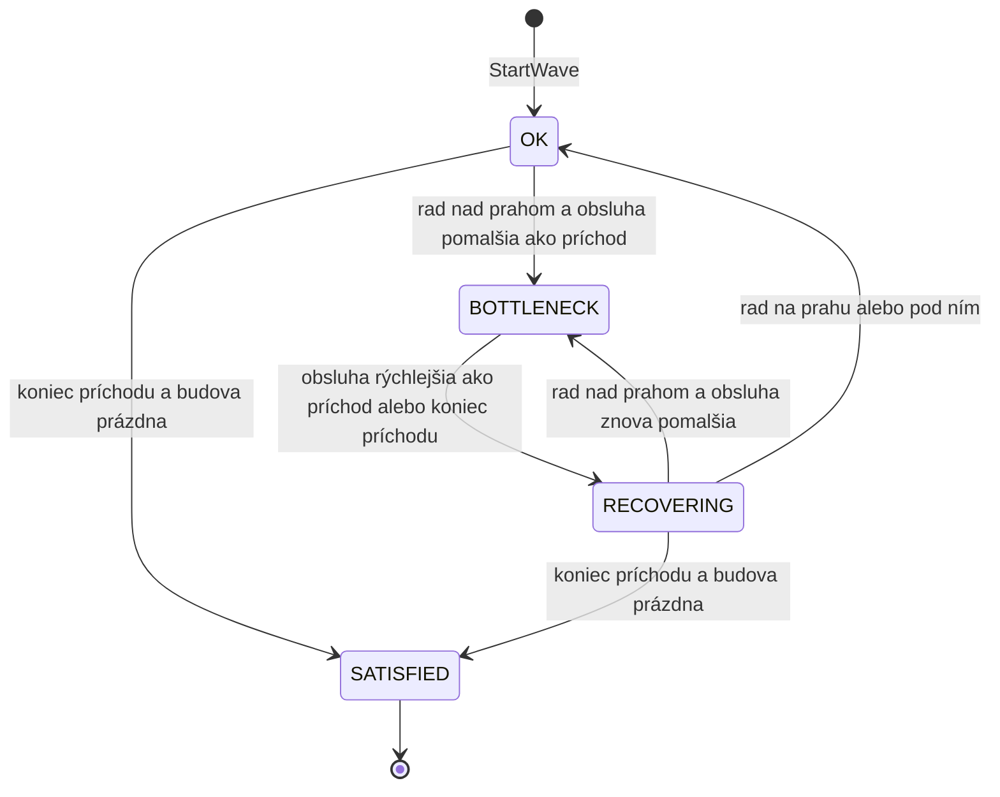

# Stavy needu počas vlny

Každý need vlny (Rooms, Food, Drinks, Relax, Ocean View) má počas vlny jeden zo štyroch stavov podľa FR-09. Stav sa prepočíta po každom kroku simulácie (0,1 s) a pri zmene `GameSimulation` vyvolá udalosť `NeedStateChanged`.

## Prechody

| Prechod | Podmienka |
|---|---|
| OK alebo RECOVERING → BOTTLENECK | príchod ešte beží, rad čakajúcich je nad prahom a rýchlosť obsluhy je nižšia ako rýchlosť príchodu |
| BOTTLENECK → RECOVERING | rýchlosť obsluhy je vyššia ako rýchlosť príchodu (napr. príde Worker, AC2), alebo sa príchod skončil |
| RECOVERING → OK | rad čakajúcich klesne na prah alebo pod neho |
| OK alebo RECOVERING → SATISFIED | príchod sa skončil a v budove nikto nečaká ani nesedí |

- **Rad** sú len jednotky, ktoré čakajú na voľné miesto (`BuildingService.WaitingCount`). Sediaci (`ActiveCount`) sa nepočítajú.
- **Rýchlosť obsluhy** = počet miest ÷ čas obsluhy jednej jednotky v tikoch, už s podielom výkonu (`BuildingService.ServiceRatePerTick`). Používa čas zaokrúhlený na tiky, teda taký, aký budova naozaj odsimuluje.
- **Rýchlosť príchodu** = objem needu vo vlne ÷ dĺžka príchodu v tikoch (`WaveModel.GetArrivalRatePerTick`).
- **Prah** je `needStateConfig.bottleneckThreshold` v `Assets/Resources/config.json` (teraz 4). Kľúč je povinný, bez neho sa konfigurácia odmietne.
- **SATISFIED** je konečný stav. Ďalší `StartWave` nastaví všetky needy na OK bez udalosti.
- **Z BOTTLENECK sa nedá ísť rovno do OK ani do SATISFIED**, vždy len cez RECOVERING. Rad pri plnej budove kolíše o jednotku pri každom usadení a pri priamom prechode by warning blikal (AC1). Keď sa rozmiestnenie Worker-ov nemení, rýchlosti sú počas vlny konštantné a každý stav nastane najviac raz.
- `GameSimulation.AllNeedsSatisfied` je pravda, keď je príchod skončený a všetky needy sú v SATISFIED, teda keď vlna skončila.

## Odchýlka od Build dokumentu

Build dokument (stav jedného needu) spúšťa BOTTLENECK, keď rad rastie aspoň `bottleneck_hysteresis_s` (3 s), a RECOVERING, keď sa rad zmenšuje. FR-09 vo v0.6 to nahrádza porovnaním rýchlosti obsluhy a príchodu. Výsledok je deterministický a nebliká. Je to rozhodnutie tímu, nie klienta.

## V kóde

| Čo | Kde |
|---|---|
| stavy a prechody | `Assets/Scripts/Simulation/NeedStateMachine.cs` |
| prepočet po každom kroku, `NeedStateChanged`, `GetNeedState`, `AllNeedsSatisfied` | `Assets/Scripts/Simulation/GameSimulation.cs` |
| testy prechodov | `Assets/Tests/NeedStateMachineTests.cs` |
| testy celých vĺn | `Assets/Tests/NeedStateIntegrationTests.cs` |
